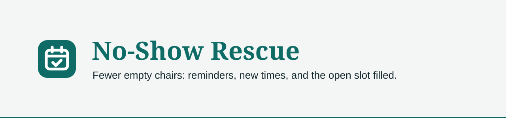

<p align="center"></p>

<p align="center">
  
  
  
  
</p>

**Fewer empty chairs: a landing page and a one-click demo of no-show rescue for dental and vet practices.**

Not deployed yet. See issue #1 for what is left.

## Status

| Row | |
|---|---|
| Phase | Live on `no-show-rescue.vercel.app` |
| Shipped | Landing page and one-click demo; outlined shape and a drawn phone frame (#10) |
| Next | Nothing open |
| Updated | 2026-11-13 |

## What it does

- A landing page that explains the fix in four steps and opens the demo with one press.
- The demo plays Pinewhistle Dental, a made-up dental practice. The visitor plays a patient, Lena.
- A reminder text arrives on a drawn phone. The patient confirms, or doesn't reply.
- A demo clock skips to 15 minutes past the visit. Nobody came: the patient gets a new-time text, and the open slot is texted to a short-notice waitlist.
- The patient picks a new time (or asks for a call). The first waitlist patient takes the open chair, and the others are told it was taken.
- After the visit, one message asks how it went. A happy patient gets the review link once. An unhappy one is asked what went wrong, and the answer goes to the front desk, not online.
- The front desk view shows the schedule, the waitlist, the patient's record and every text that would have gone out.

## What it never does

- Sends anything. No SMS, no email, no AI call leaves the browser.
- Keeps anything on a server. The demo lives in the page's memory; a reload starts over (ADR 0001).
- Shows a real practice, a real person, patient data, a price, a statistic or a phone number.
- Lets search engines index the demo. Only the landing page is indexed.

## Stack

Next.js 16 (App Router) and Tailwind 4 on Vercel. No database, no API routes. Vitest for unit tests.

## Run it locally

Needs Node 24 and npm. No env vars.

```bash
npm install
npm run dev
```

## Tests

`npm run test:unit`. Never `npm test` (it fails on purpose). CI runs typecheck, lint, `test:unit` and the build on every PR.

## Docs

- `DESIGN.md`: the look, colors, type and the logo status.
- `PRODUCT.md`: who it is for and the voice.
- `CONTEXT.md`: the words the code uses.
- `docs/adr/0001-browser-only-demo.md`: why there is no backend.
- `docs/design/logos.html`: the three logo options.

---

<p align="center">Built by <a href="https://tekguyz.com">TEKGUYZ</a></p>
